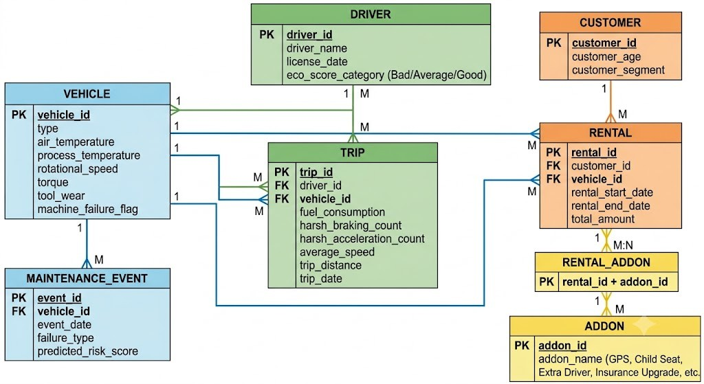
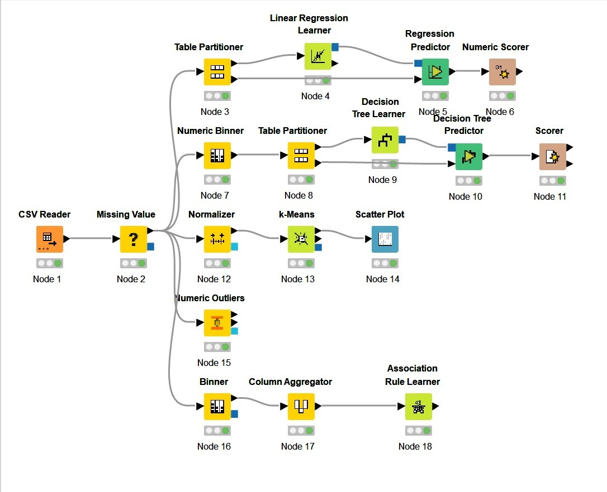
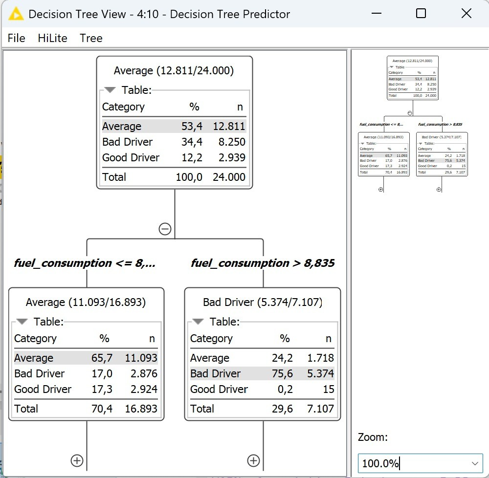

# sixt-predictive-maintenance
Data mining and business analytics workflows for SIXT SE, featuring predictive maintenance, driver profiling, and bundle sales optimization using KNIME.
# SIXT SE: Advanced Fleet Intelligence & Predictive Analytics Architecture


## 📌 Project Overview
This project applies Knowledge Discovery in Databases (KDD) processes to solve three operational challenges for SIXT SE, a mobility service provider with a fleet of over 240,000 vehicles. Developed entirely within the KNIME Analytics Platform, the project leverages data mining to optimize maintenance strategies, analyze driver behavior, and maximize sales revenue.

**Authors:** Satı Sıla Yolcu, Emre Hekimoğlu, Kaan Bilben.

📄 **Full project report:** [Data_Mining_Report.pdf](docs/Data_Mining_Report.pdf) ([.docx](docs/Data_Mining_Report.docx))

## 🎯 Strategic Business Domains & Methodology
The three problems share one logical data model (vehicles, drivers, trips, maintenance events, rentals and add-ons):

<p align="center"></p>

The analytical pipeline addresses three enterprise-level challenges using distinct datasets and machine learning algorithms:

### 1. Predictive Maintenance
* **Objective:** Predict potential vehicle failures to schedule maintenance before unexpected breakdowns occur.
* **Dataset:** AI4I 2020 Predictive Maintenance Dataset (10,000 samples; 2,000 held out for testing).
* **Methodology:** Implemented a Decision Tree classification algorithm to create an interpretable, rule-based model for maintenance engineers.
* **Data Processing:** Handled missing sensor readings using mean/median imputation and removed irrelevant identifier columns.

### 2. Driver Behavior Profiling
<p align="center"></p>
<p align="center"><sub>KNIME workflow for driver profiling: normalization, k-Means clustering and a surrogate Decision Tree.</sub></p>

* **Objective:** Group drivers into categories to understand behavior, assess risk, and improve vehicle longevity.
* **Dataset:** Eco-driving behavior dataset (30,000 trip records; 24,000 in the training partition).
* **Methodology:** Applied the k-Means clustering algorithm to discover natural groupings, alongside a surrogate Decision Tree to make the numeric clusters human-readable.
* **Data Processing:** Normalized numeric features (e.g., fuel consumption, braking counts) to a [0,1] range to ensure algorithm stability.

### 3. Bundle Sales Optimization
* **Objective:** Discover which add-on items are frequently rented together to optimize product recommendations and packages.
* **Dataset:** Car Rental transactional dataset.
* **Methodology:** Utilized Association Rule mining (Apriori-style) to identify frequent itemsets and generate rules based on Support, Confidence, and Lift metrics.
* **Data Processing:** Converted individual rental line-items into a single basket format per transaction using a Column Aggregator node.

## 📊 Business Value Realization & Insights

### Predictive Maintenance Insights
* **Model Performance:** The Decision Tree model achieved an overall accuracy of 98.2% and a Cohen's Kappa of 0.68.
* **Business Action:** SIXT can transition from a preventive maintenance approach to a predictive one, focusing inspections only on vehicles flagged as problematic to minimize unexpected breakdown costs.
* **Deployment Recommendation:** In a production deployment, the decision threshold should be tuned to reduce false negatives (24 missed failures in the test set) to prevent critical system misses.

### Driver Profiling Insights
<p align="center"></p>
<p align="center"><sub>The surrogate Decision Tree's first split is on fuel consumption (8.835 L/100km).</sub></p>

* **Model Performance:** The k-Means algorithm successfully segmented drivers into "Bad Driver", "Average", and "Good Driver" clusters. The surrogate Decision Tree yielded an accuracy of 82.267% in classifying these generated categories.
* **Key Differentiator:** Fuel consumption was identified as the single strongest differentiator; drivers with fuel consumption > 8.835 L/100km are overwhelmingly (75.6%) classified as "Bad Driver".
* **Business Action:** SIXT can use this high fuel consumption threshold to make decisions about risk-based insurance deposits, provide targeted eco-driving trainings, or reassign vehicles to extend fleet lifespan.

### Bundle Sales Insights
* **Model Performance:** The Association Rule Learner outputted zero qualifying rules at the default minimum support and confidence thresholds.
* **Business Action:** This indicates that the purchasing pattern of add-ons for SIXT is highly fragmented, with no single add-on mix being disproportionately popular.
* **Strategic Recommendation:** SIXT should reduce the minimum support threshold (e.g., from 10%-20% down to 1%-5%) and segment customers based on demographics (like age) before running the analysis again to uncover hidden moderately common bundles.

## 📂 Repository Structure
```
├── workflows/
│   ├── Predictive_Maintenance.knwf        # Decision Tree on AI4I 2020
│   ├── Eco_Driving_Score.knwf             # k-Means + surrogate Decision Tree
│   └── Car_Rental_Bundle_Analysis.knwf    # Association Rule mining
├── data/
│   ├── predictive_maintenance/ai4i2020.csv
│   ├── eco_driving/eco_driving_score.csv
│   └── car_rental/Car_Rental_SLStyle_18Months.csv
└── docs/
    ├── Data_Mining_Report.pdf
    ├── Data_Mining_Report.docx
    └── images/
```

## ▶️ Running the Workflows
1. Clone this repository.
2. Open KNIME Analytics Platform.
3. Go to `File -> Import KNIME Workflow...` and select a `.knwf` file from `workflows/`.
4. Point each workflow's CSV Reader node to the matching file under `data/`, then execute the pipeline.
